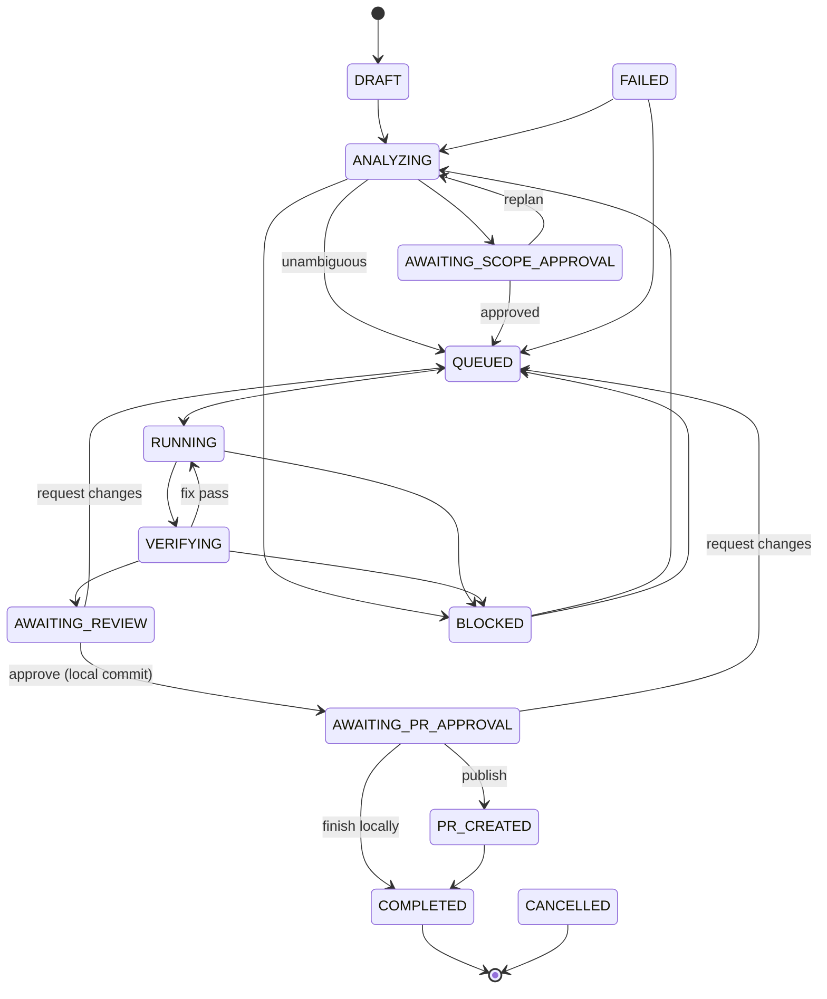

# Architecture

Orbit is a TypeScript monorepo (pnpm workspaces). One Node process hosts the API, the dashboard, the mission workers and the Asana poller. State lives in SQLite under `ORBIT_HOME` (default `~/.orbit`).

```
                ┌─────────── entry points ───────────┐
 Dashboard (React) ── HTTP/SSE ─┐                     │
 orbit CLI ──── HTTP (bearer) ──┤                     │
 Claude Code ── MCP stdio → HTTP┤                     │
 Asana /orbit run ── Events API poll (TriggerService) │
                                ▼                     │
                     ┌──────── apps/server ────────┐
                     │ Fastify: auth, routes, SSE  │
                     └─────────────┬───────────────┘
                                   ▼
               ┌──────────── packages/core ─────────────┐
               │ MissionService  (state machine, gates) │
               │ Pipeline        (analyze/execute/publish)
               │ JobQueue+Worker (durable, leased)      │
               │ Outbox          (idempotent side effects)
               │ RepoService · Router · Notifier · Doctor
               └──┬──────────┬───────────┬──────────┬───┘
                  ▼          ▼           ▼          ▼
            @orbit/agents @orbit/git @orbit/integrations-asana @orbit/database
            (runtimes)    (git, gh)  (TaskProvider impl)       (SQLite, Drizzle)
```

## Packages

| Package | Responsibility |
|---|---|
| `shared` | DTOs, the mission state machine, settings schema (Zod), redaction, unified-diff parser, command-line tokenizer, `/orbit` command parser |
| `database` | Drizzle schema, embedded SQL migrations (no files needed at runtime), connection setup (WAL, foreign keys) |
| `git` | Shell-free process runner (execa), `Git` wrapper (worktrees, diffs, commits, push), `GhCliClient`, repository inspection and command detection |
| `integrations` | Provider-neutral `TaskProvider`, `ExternalTask`, trigger and sync-state types |
| `integrations-asana` | `AsanaClient` (pagination, Retry-After, backoff, rate budget, concurrency caps) and `AsanaProvider` (events, reconciliation, comments) |
| `agents` | `AgentRuntime` interface; Claude Agent SDK, Claude Code CLI and scripted runtimes; role prompts and output schemas; tool policy; agent environment allowlist |
| `core` | Everything stateful: missions, pipeline stages, queue, outbox, triggers, notifier, overview, doctor, receipts |
| `client` | Typed HTTP client used by the CLI and MCP bridge |
| `mcp` | MCP server exposing Orbit tools to Claude Code |
| `server` | Fastify app, local auth, SSE, static dashboard |
| `web` | Dashboard |
| `cli` | `orbit` command; bundled with tsup (workspace packages inlined) |

The core never imports Asana concepts directly: it talks to `TaskProvider`. A new tracker is a new package implementing that interface plus a provider factory entry.

## Mission state machine

Defined once in `packages/shared/src/mission.ts` and enforced by `MissionService.transition` (optimistic concurrency on the current status).



`CANCELLED` and `FAILED` are reachable from every non-terminal working state (see the source for the full table). A unit test asserts that `PR_CREATED` is reachable only from `AWAITING_PR_APPROVAL`.

Each repository in a mission has its own work item (`mission_repos`) with a sub-status (`selected`, `in_progress`, `ready_for_review`, `changes_approved`, `publishing`, `pr_created`, `local_only`, …), branch, worktree, base SHA, commit, diff stats and PR. Multi-repository missions run repositories sequentially and are approved and published per repository.

## Data model (SQLite)

`repos`, `integrations`, `authorized_users`, `external_projects`, `project_repos`, `missions`, `mission_revisions` (requirement snapshots), `mission_repos`, `mission_events` (durable history, streamed live), `agent_runs`, `verifications`, `reviews`, `approvals`, `jobs`, `triggers`, `side_effects`, `audit_log`, `settings`.

Two partial unique indexes carry important guarantees:

- `missions(active_key) WHERE active_key IS NOT NULL`: at most one active mission per external task, even under duplicate events or races.
- `jobs(dedupe_key) WHERE status IN ('queued','running')`: at most one live job per mission stage.

## Durable execution

- **Queue**: jobs are claimed in a transaction (better-sqlite3 is synchronous, so claims cannot race), leased, and heartbeated while running. Two lanes: `agent` (analyze, execute; concurrency from settings) and `io` (publish, notify).
- **Recovery** (`Orbit.recover` at startup): jobs left `running` are re-queued; agent runs and verifications marked interrupted; missions in working states without a job get one; repositories stuck in `publishing` resume publishing.
- **Outbox** (`side_effects`): every outward operation has an idempotency key. If an earlier attempt is uncertain, Orbit checks before acting: remote branch SHA before pushing, existing PR for the branch before creating one, a marker in the comment footer before posting to Asana.
- **Requirement snapshots**: the task is snapshotted when the mission starts. Later edits flag the mission ("task changed") and require an explicit replan, which creates a new revision.

## Pipeline

1. **Analyze**: resolve authorized candidate repositories (explicit selection or project mapping, `allowModify` only), refresh summaries when HEAD moved, score keyword evidence, run the read-only planner with structured output, drop unauthorized suggestions, decide whether scope approval is needed.
2. **Execute** per repository: fetch, create a worktree on a new branch from `origin/<default>` (or the local default), run setup commands once (files they create are excluded from the change; tracked files they modify are restored), run the engineer, stage and diff, scan for secrets, run verification commands, run the reviewer, loop on failures up to the configured number of fix passes, then hand over for review.
3. **Approve changes**: secret scan, local commit (message via stdin), PR draft (task link and requirement text only for private repositories unless enabled).
4. **Publish** (after explicit approval): push without force, create the PR through `gh`, both via the outbox; then notify the task.

## Agents

`AgentRuntime.run(request, { signal, onEvent })` returns a normalized result (status, text, structured output, cost, usage, turns). Agent text is shown but never used as evidence.

- **Claude Agent SDK**: `query()` with an explicit tool list, `permissionMode: 'dontAsk'`, `settingSources: []` (repository settings cannot loosen policy), the Claude Code system prompt plus role instructions, `outputFormat` JSON schema, `maxBudgetUsd`, sandbox settings in sandbox mode, and a `PreToolUse` hook enforcing Orbit's tool policy. Requires an API key or cloud provider credentials.
- **Claude Code CLI**: `claude -p --output-format stream-json --restricted --tools … --disallowedTools … --permission-mode dontAsk --json-schema …`, prompt on stdin, environment allowlisted.
- **Scripted**: deterministic, no AI; tests and demos.

Roles: planner and reviewer are read-only (Read, Glob, Grep). The engineer may edit inside the worktree and run commands; `git push`, `git commit`, `gh`, publishing and remote shells are denied.

## Asana triggers

`TriggerService` polls each enabled project with the Events API and a persisted sync token (first poll only establishes a token, so old comments never run). Comment events become candidates; each is stored once by story id (`triggers.dedupe_key`), then authorized against `authorized_users`. Expired tokens (412) and a periodic schedule trigger a bounded reconciliation scan of recently active tasks. Asana does not bump `modified_at` for new comments, so reconciliation is best effort; duplicates are filtered by story id. Orbit's own comments are ignored.

## Local API and auth

- Binds to `127.0.0.1` (non-loopback requires `--allow-remote`).
- Every `/api` route except `/api/health` requires the token from `ORBIT_HOME/auth.json`: as a bearer token (CLI, MCP) or an HttpOnly, SameSite=Strict cookie set by the `/auth?token=…` sign-in link (dashboard).
- `Host` must be a loopback name (DNS-rebinding protection); writes with a foreign `Origin` are rejected.
- Live updates over Server-Sent Events (`/api/stream`).

## Building and shipping

- Development: `tsx` runs TypeScript sources directly; Vite serves the dashboard with a proxy.
- Release: `pnpm build` builds the dashboard and bundles the CLI (`packages/cli/dist/orbit.js`) with the dashboard in `dist/web`. Native dependency: `better-sqlite3` (prebuilt binaries for common platforms).
